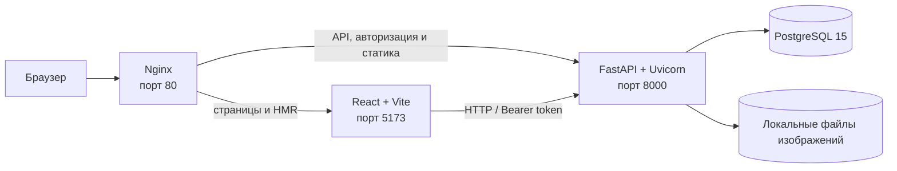

# T-Travel — путешествия глазами местных

**T-Travel Local Guides** — платформа для поиска авторских экскурсий и знакомства с городом через людей, которые знают его лучше всех. Путешественник выбирает маршрут, дату и размер группы, а местный гид представляет свои экскурсии, управляет расписанием и получает бронирования.

Проект объединяет клиентский интерфейс, API, базу данных и инструменты управления в одном приложении — от первой публикации экскурсии до отзыва после поездки.

## Почему это интересно

- **Два участника — одна площадка.** Путешественники находят впечатления, гиды создают предложения и развивают собственный профиль.
- **Путь от поиска до поездки.** Каталог, фильтры по направлению и дате, доступность мест, бронирования, избранное и отзывы связаны в едином пользовательском сценарии.
- **Качество каталога под контролем.** Заявки гидов и публикации экскурсий проходят через административную модерацию.
- **Есть продуктовый фундамент для развития.** Уже представлены ключевые роли, профили, расписания, статусы заказов и база данных с версионируемой схемой.

## Возможности

### Путешественникам

- искать одобренные экскурсии по стране и городу, выбирать дату, количество участников и сортировку;
- изучать карточки экскурсий, профили гидов, фотографии и отзывы;
- проверять доступные даты и время;
- бронировать экскурсии, просматривать свои бронирования и отменять их;
- сохранять понравившиеся предложения в избранное и оставлять отзывы.

### Гидам

- подать заявку на роль гида;
- после одобрения администратора заполнить профиль, добавить фотографию и информацию об опыте;
- создавать и редактировать экскурсии, загружать фотографии;
- задавать регулярное расписание и отдельные временные слоты;
- управлять экскурсиями и просматривать связанные с ними бронирования.

### Администраторам

- просматривать пользователей, гидов и бронирования;
- одобрять заявки гидов;
- проверять экскурсии и менять их статус;
- управлять содержимым платформы через отдельную административную панель.

## Как устроен проект



### Frontend

Одностраничное приложение на **React 19** с маршрутизацией через **React Router**. Код организован вокруг страниц, повторно используемых компонентов, API-клиентов и общего контекста авторизации. Сборку и локальную разработку обеспечивает **Vite**; интерфейс использует **Material UI**.

Основные пользовательские разделы — главная страница и поиск, карточка экскурсии, профиль путешественника, бронирования и избранное. Для гидов предусмотрены панель управления, форма экскурсии, календарь и редактор расписания. Административная панель загружается отдельно по требованию.

### Backend

**FastAPI** предоставляет HTTP API и автоматически формирует документацию OpenAPI. Эндпоинты сгруппированы по зонам ответственности: авторизация, экскурсии и бронирования, профили гидов, административное управление и загрузки.

**SQLAlchemy 2** описывает сущности и связи предметной области; запросы приложения выполняются асинхронно через **asyncpg**. **Pydantic** используется для настроек и схем API. Аутентификация построена на **FastAPI Users** и Bearer/JWT-токенах; доступ к операциям зависит от роли и статуса пользователя.

### Данные и инфраструктура

- **PostgreSQL 15** хранит пользователей, гидов, экскурсии, расписания, бронирования, отзывы, избранное и связанные записи.
- **Alembic** хранит историю изменений схемы. При старте контейнера backend применяет миграции до запуска API.
- **Docker Compose** поднимает базу данных, API, клиент и Nginx; сервисы связаны внутренней сетью Compose.
- **Nginx** направляет запросы к интерфейсу и API, обслуживает WebSocket-соединение Vite и задаёт лимит размера запроса для загрузок.
- Фотографии экскурсий и гидов сейчас хранятся в локальном каталоге `backend/assets`, подключённом как Docker volume.

Ключевые связи модели: пользователь может иметь профиль клиента и/или гида; гид публикует экскурсии; экскурсия имеет расписание, бронирования, отзывы и избранное; бронирование связано с клиентом и записью платежа.

## Технологии

| Область | Технологии |
| --- | --- |
| Интерфейс | React 19, React Router 6, Vite 7, Material UI 5 |
| API | Python 3.12, FastAPI, Uvicorn, Pydantic 2 |
| Доступ к данным | SQLAlchemy 2, asyncpg, PostgreSQL 15 |
| Авторизация | FastAPI Users, JWT/Bearer |
| Миграции | Alembic |
| Запуск и маршрутизация | Docker, Docker Compose, Nginx |
| Проверки | pytest, HTTPX; ESLint для frontend |
| CI | GitHub Actions собирает Docker-образы backend и frontend |

## Запуск для разработки

### Требования

- Docker Desktop с поддержкой `docker compose`;
- Git.

### 1. Получите проект

```bash
git clone https://github.com/Zorigto37122/t-travel-local-guides.git
cd t-travel-local-guides
```

### 2. Подготовьте локальную конфигурацию

Compose ожидает в корне проекта два локальных файла — `pg.env` и `secrets.env`. Они не должны попадать в Git.

В `pg.env` задаются параметры подключения приложения к БД:

```dotenv
DB_HOST=db
DB_PORT=5432
DB_USER=<пользователь PostgreSQL>
DB_PASS=<пароль PostgreSQL>
DB_NAME=<имя базы данных>
```

`DB_USER`, `DB_PASS` и `DB_NAME` должны соответствовать настройкам сервиса PostgreSQL в `docker-compose.yml`.

В `secrets.env` задаются отдельные секреты приложения:

```dotenv
SECRET=<длинный случайный секрет приложения>
RESET_PASSWORD_TOKEN_SECRET=<отдельный случайный секрет>
VERIFICATION_TOKEN_SECRET=<отдельный случайный секрет>
```

Используйте свои случайные значения, не переиспользуйте секреты между окружениями и не публикуйте эти файлы. Для production-среды секреты следует передавать через защищённое хранилище секретов.

### 3. Запустите приложение

```bash
docker compose up --build
```

При первом старте Docker соберёт образы, дождётся готовности PostgreSQL, применит миграции и запустит сервисы.

| Сервис | Адрес |
| --- | --- |
| Приложение через Nginx | [http://localhost](http://localhost) |
| Frontend dev server | [http://localhost:5173](http://localhost:5173) |
| Backend API | [http://localhost:8000](http://localhost:8000) |
| Swagger UI | [http://localhost:8000/docs](http://localhost:8000/docs) |

Остановка:

```bash
docker compose down
```

Чтобы удалить также сохранённые данные PostgreSQL, потребуется отдельно удалить volume `postgres_data`. Это необратимо удалит локальную базу; не выполняйте такую очистку, если данные нужно сохранить.

### Учётная запись администратора

Сначала зарегистрируйте пользователя через приложение, затем назначьте ему права администратора:

```bash
docker compose exec backend python -m scripts.make_admin ваш_email@example.com
```

Команда использует существующего пользователя — она не создаёт новую учётную запись.

## Разработка и проверки

В frontend-папке доступны команды:

```bash
cd frontend
npm ci
npm run dev
npm run build
npm run lint
```

Backend-зависимости и тесты:

```bash
cd backend
pip install -r requirements_local.txt
python -m pytest tests
```

Для локального запуска backend вне Docker необходимы `pg.env` и `secrets.env` с корректным подключением к PostgreSQL. В `requirements_local.txt` включены дополнительные зависимости для тестов.

## Структура репозитория

```text
backend/
  src/
    auth/          авторизация и менеджер пользователей
    routers/       HTTP API по функциональным областям
    schemas/       схемы запросов и ответов
    models.py      ORM-модели и связи
    database.py    асинхронное подключение к БД
  alembic/         конфигурация и версии миграций
  assets/          изображения экскурсий и гидов
  scripts/         служебные команды
  tests/           тесты авторизации
frontend/
  src/
    api/           клиенты API
    components/    переиспользуемые элементы интерфейса
    pages/         страницы и пользовательские кабинеты
    layouts/       общая структура страниц
nginx/
  nginx.conf       маршрутизация frontend/API
docker-compose.yml
```

## Текущие границы проекта

В репозитории реализованы основные пользовательские сценарии платформы, однако текущая конфигурация Compose запускает frontend через Vite в режиме разработки. Это удобный контур для локальной разработки и демонстрации, но не готовый production-релиз. Перед публичным запуском потребуются отдельная production-сборка и конфигурация frontend, безопасная настройка секретов, хранение медиа вне контейнерного локального каталога и проверка инфраструктуры под целевую нагрузку.

В модели данных предусмотрены платёжные записи и статусы, но README не предполагает подключение внешнего платёжного провайдера: интеграцию следует оценивать отдельно по реализации и бизнес-требованиям.

## Связанные материалы

- [Устранение проблем с подключением к API](./TROUBLESHOOTING.md)
- [Руководство по участию в разработке backend](./backend/CONTRIBUTING.md)

---

**T-Travel Local Guides** — технологическая основа для более человечного способа путешествовать: находить не просто маршрут, а человека, который откроет город изнутри.
